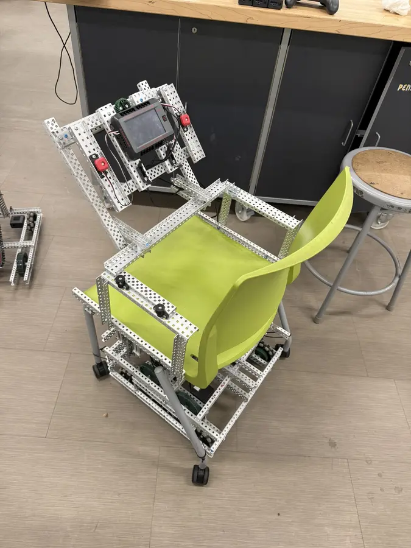
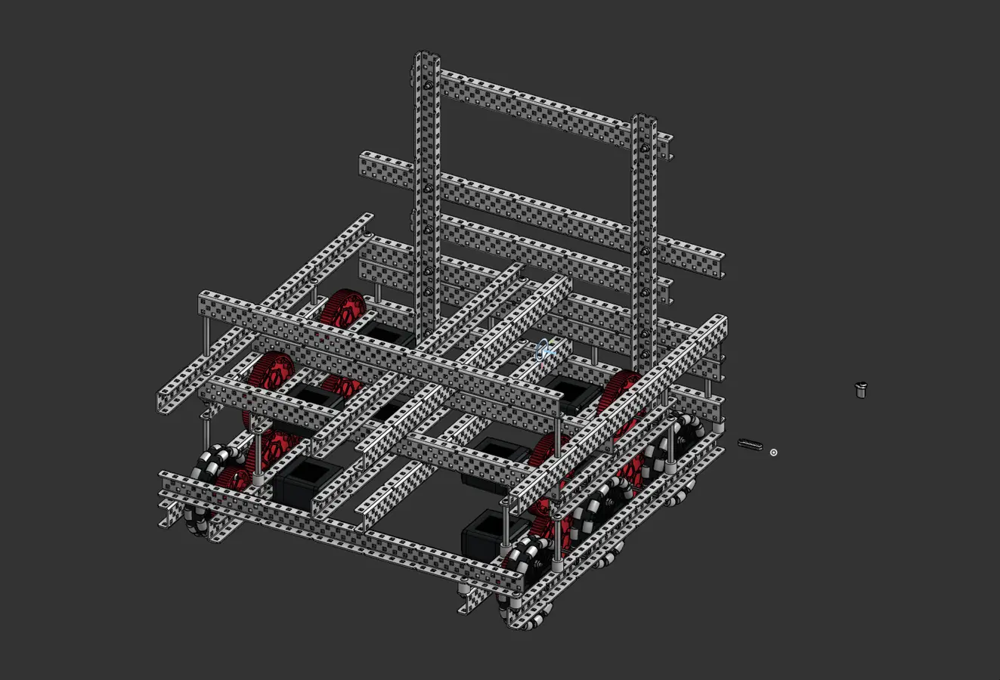
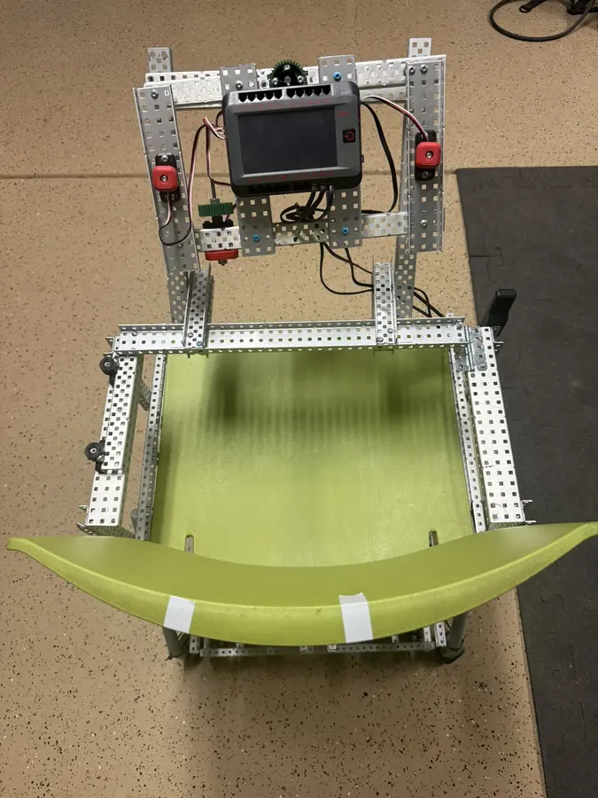
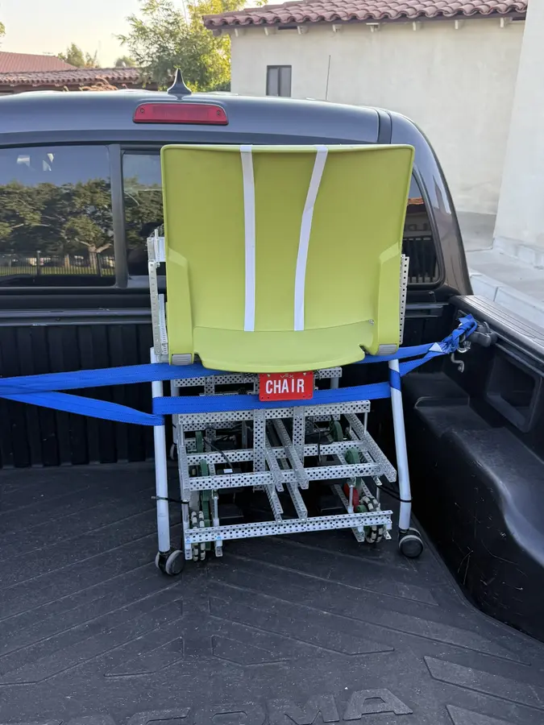

# The Chair

I turned a school chair into a go-kart. Eight VEX V5 motors, three Brains, and all the firmware written in Rust.

[](https://github.com/gmhs-robotics/the-chair/actions/workflows/rust.yml)


**[Explore the CAD](https://cad.onshape.com/documents/9a8c18891301aa8b92cf775c/w/e2064653b9b5e6534297f6f2/e/1f7830fac36eec9a8cd147fd)** · **[Watch it drive](media/video/driving-exterior.mp4)** · **[Build log](https://stardance.hackclub.com/projects/4170)** · **[Hack Club feature](https://www.instagram.com/projects.hackclub/reel/DelxenFK0ug/)**



It goes around 4.3 mph, vroom vroom! I can drive it with the steering wheel and Rotation Sensor throttle or a V5 Controller. It goes forward, reverses, and turns in place.

I drove it around at Club Day to show off our robotics club. We went from **12 members last year to over 32 this year**. A moving school chair makes a pretty good recruitment pitch.

Hack Club even made a [video about my chair on @projects.hackclub](https://www.instagram.com/projects.hackclub/reel/DelxenFK0ug/)!

## How this happened

My friends and I saw the chairs in our robotics lab and immediately wanted to turn one into a go-kart. School chair. Robotics parts. Obviously those needed to go together. We started messing with the idea during lunch, and eventually I picked it back up and committed to making the thing drive.

I started with a Rio 2 chair and designed a printed bracket to connect its angled seat base to a flat VEX frame. That turned into armrests, a drivetrain, a steering wheel, and an increasingly ridiculous amount of metal underneath an otherwise normal green chair. Every addition gave me another problem to solve: getting the mounting holes right, strengthening the frame, supporting the rider, and keeping the steering wheel from wobbling.

The drivetrain had its own learning curve. At one point I built it and realized the gear was bigger than the wheel. Great drivetrain, except for the part where it needed to touch the floor. I rebuilt, adjusted, reinforced, and kept going. I documented the whole process on [Stardance](https://stardance.hackclub.com/projects/4170), including the parts that took more than one try.

Then I had to make eight motors, three Brains, and my controls agree on what driving actually meant. I wrote the firmware in Rust, built the communication between the Brains, added steering feedback, and put motor temperatures, batteries, and faults on the dashboard. Getting everything talking reliably took a lot of debugging. Finally sitting down and driving something I had built and programmed made all of that worth it.

## Taking it to Club Day

I wanted to use the chair to show people what we do in robotics. So for Club Day, I drove it around to showcase our club. All the work on the frame, controls, and software became something people could see moving right in front of them.

That's what I love about this project. I can talk about CAD, code, and motors, but I can also get in a chair and drive it around. It's funny, it's a little ridiculous, and it gives people a reason to get interested in building things themselves.

We ended up getting a bunch of new members: **12 last year, over 32 this year**. More than twice as many people in our robotics club! The chair became part of how we showed off the club, and now we've got a lot more people to build things with.

## At a glance

| Feature | Details |
| --- | --- |
| Drive | Eight VEX V5 motors; four per side |
| Control | Steering wheel and signed Rotation Sensor throttle, or V5 Controller |
| Computing | Three V5 Brains running Rust with vexide |
| Feedback | Steering resistance, live dashboard, motor and battery telemetry |
| Mechanical design | [Onshape assembly and drivetrain](hardware/cad/README.md) |
| Speed | Around 4.3 mph |
| Status | Built, programmed, and driven by me |
| Club Day | Drove it to showcase robotics; club grew from 12 to over 32 members |

## See it in action

- [Driving from the seat](media/video/driving-pov.mp4)
- [Exterior driving test](media/video/driving-exterior.mp4)
- [Dashboard and controls](media/video/hud-demo.mp4)

## CAD and construction

[](https://cad.onshape.com/documents/9a8c18891301aa8b92cf775c/w/e2064653b9b5e6534297f6f2/e/1f7830fac36eec9a8cd147fd)

I modeled the chair and drivetrain in [Onshape](https://cad.onshape.com/documents/9a8c18891301aa8b92cf775c/w/e2064653b9b5e6534297f6f2/e/1f7830fac36eec9a8cd147fd). Open the assembly to look through the wheelbase, frame, motor/gear assemblies, and wheels. I also kept my bracket exports, chair models, and scans under [hardware](hardware/README.md).

 

More build photos and progress updates are on [my Stardance project](https://stardance.hackclub.com/projects/4170). The [media directory](media/README.md) has the photos and driving videos together.

## How it works

I split the work across three V5 Brains:

- **Master / slot 1:** reads my throttle on P17 and steering motor encoder on P21, handles steering feedback, and runs the dashboard. It takes input from the wheel or V5 Controller, mixes the drive commands, and sends LEFT through P19 and RIGHT through P20.
- **LEFT / slot 2:** receives commands on P21 and drives the four left motors on P4–P7.
- **RIGHT / slot 3:** receives commands on P21 and drives the four right motors on P4–P7.

Commands go out, health comes back. Both drive Brains check their motors, battery, and command timeout, then send telemetry back to the master. I flipped the top and bottom motors' software polarity to match the way their gears face.

Getting three Brains to talk reliably was the hardest software problem. I built the serial protocol around Postcard, COBS framing, and CRC-32, with startup handshakes, side assignment, retries, and sequence checks. Each drive command has a 150 ms lease, so a lost link stops that drivetrain. The Brains send back motor temperatures, battery status, speed, and faults for the live dashboard.

## Controls

For the startup and driving sequence, see the [operator guide](docs/OPERATING.md).

<details>
<summary>Wheel mode, controller mode, and stop behavior</summary>

In **WHEEL** mode, P17 controls forward and reverse speed in 10% steps. The left wheel button on ADI A must be held to drive. The steering wheel has a 10° deadzone and reaches full steering at ±80°. Steering still works with P17 at zero, allowing the chair to turn in place. Full right steering requests `LEFT=1, RIGHT=-1`; full left requests `LEFT=-1, RIGHT=1`.

In **CONTROLLER** mode, left stick Y controls speed and direction while right stick X controls steering. Centering both sticks coasts. Holding L1 coasts; holding B requests electrical Brake. P17 is ignored in this mode, and controller loss during active operation stops the chair instead of falling back to WHEEL mode.

The display provides MODE and RECENTER controls. Center the wheel and P17 throttle before starting the master program. Once both drive Brains are healthy and controls have been neutral for half a second, the chair turns ON automatically. The right wheel button on ADI B requests electrical Brake in both modes. Release B, let the chair stop, and hold controls neutral for half a second; then driving can resume. Motor heat produces a visible warning and automatic power reduction; accumulated drive time gives rest advice. Missing Brains, missing motors, failed health, link, input and battery checks trigger a latched **E-STOP**. Fix the cause and restart all three programs.

</details>

## What I built

- [x] Build and mount the eight-motor drivetrain.
- [x] Reinforce the chair frame and steering assembly.
- [x] Install three Brains, two batteries and rider controls.
- [x] Implement steering feedback and both driving modes.
- [x] Implement serial communication, telemetry, HUD and fault handling.
- [x] Get in and drive it!

## Reproduce it

### Hardware and CAD

Start with my [Onshape CAD guide](hardware/cad/README.md) and [hardware files](hardware/README.md). The spreadsheet has my drivetrain calculations and comparisons, and the Onshape assembly shows how the wheelbase fits together.

The printed mounting bracket gives the angled seat base a flat connection to the VEX frame. My scans, bracket files, and drivetrain calculations are all under [`hardware/`](hardware/).

### Port map

<details>
<summary>Three-Brain connections</summary>

| Brain | Port | Connection |
| --- | --- | --- |
| Master | P17 | Rotation Sensor throttle |
| Master | P18 | Optional V5 radio |
| Master | P19 | Serial link to LEFT P21 |
| Master | P20 | Serial link to RIGHT P21 |
| Master | P21 | Steering feedback motor |
| Master | ADI A | Hold-to-run / rider brake button |
| Master | ADI B | Rider electrical Brake while held |
| LEFT | P4–P7 | Four LEFT drive motors |
| RIGHT | P4–P7 | Four RIGHT drive motors |

P21 has a different purpose on each Brain: it connects to the steering motor on the master and carries serial data on each drivetrain Brain. See the complete [wiring guide](docs/WIRING.md) before connecting anything.

</details>

### Software

The Nix shell contains the pinned Rust, cargo-v5, rustfmt, Clippy and mdBook environment.

```sh
nix develop
./check.sh
./upload.sh controller left right
```

`check.sh` runs formatting, tests, Clippy, RustSec, all three firmware builds, shell checks and the documentation book. Upload slots are master `1`, LEFT `2` and RIGHT `3`. Uploading does not start the programs.

## Safety

The chair weighs about 36 lb. I weigh about 140 lb, and it carries me around on eight VEX motors.

I keep the wiring, stop behavior, power-system notes, and physical checks in the [wiring guide](docs/WIRING.md), [safety guide](docs/SAFETY.md), and [commissioning checklist](docs/COMMISSIONING.md).

Test changes with the drive wheels raised before testing on the floor. Check motor direction, steering direction, B braking, motor temperature and stopping distance before carrying anyone else. Use a clear area and a spotter, keep hands and clothing away from the gears, and do not treat software stopping as a mechanical brake or independent power disconnect.

## Documentation

- [Wiring and ports](docs/WIRING.md)
- [Operator guide](docs/OPERATING.md)
- [Dashboard reference](docs/HUD.md)
- [Control and safety design](docs/SAFETY.md)
- [Commissioning checklist](docs/COMMISSIONING.md)
- [Development and toolchain](docs/DEVELOPMENT.md)

## Repository

Firmware is under `crates/`, working CAD and calculations are under `hardware/`, media is under `media/`, and the detailed field guide is under `docs/`.

## License

MIT. See [LICENSE](LICENSE).
